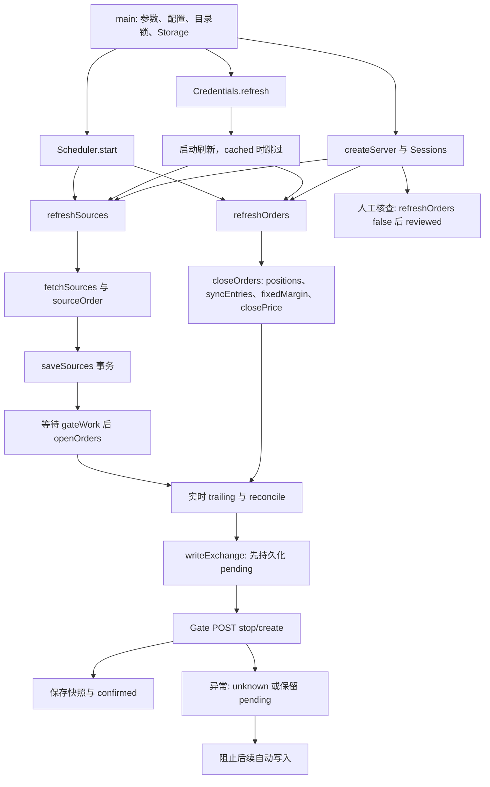

# Orders3 按执行流程的代码审查报告

## PR #34 后续处理

本 PR 已扩展为按评论修复。下表说明处理方式；正文 F01—F12 的行号和缺陷描述仍指原审查基线，不代表新代码保持原状。远端验证见 PR 检查页和 docs/verification.md。

| 项目 | 本次处理 |
| --- | --- |
| F01 | 使用合并后的启动配置选择配置路径，进程环境优先 |
| F02 | 跨月搜索归零时分，不漏月首执行 |
| F03 | 空来源和空缓存仍读取实时订单，无凭证明确报错 |
| F04 | 每轮重读七天成交，以独立身份表去重，允许补入水位前迟到记录；展示历史仍保留100条 |
| F05 | 任务持有连接租约，忙时拒绝保存，Infisical 更新等任务结束 |
| F06 | 保留旧保护并明确提示人工替换；没有启用未经验证的自动原子替换或先建后停 |
| F07 | 写前保存原 Key 指纹和请求关联，创建携带唯一 text；解除须同指纹、人工依据和实时读取。指纹不是账户ID，旧无身份记录禁止在线解除 |
| F08 | 分别持久化并展示持仓、订单同步时间 |
| F09 | 正文读取和 JSON 解析失败标记请求失败，日志保留独立 HTTP 状态；业务成功仍由 Gate 层判断 |
| F10 | 后台重读不再重建表单，只有明确保存成功才重置 |
| F11 | 区分加载、读取失败和空状态，失败不再声称无待核对请求 |
| F12 | SSH 接受工作流传入的不可变 digest，并保留严格字符校验 |

自定义 text 格式依据：[Gate 官方 CreateTrailOrder 文档](https://www.gate.com/docs/developers/apiv4/en/futures/)。关联标识帮助人工核对，不是交易所幂等保证。R01—R10 仍需对应外部条件验收，CI 夹具不能替代实盘验收。

## 审查结论与边界

审查日期：2026-10-18。对应 [issue #33](https://github.com/C0verSnow/Orders3/issues/33)。基线为默认分支 `mian` 的提交 `358df625c0390e29b47900df523e681b4cb4cabe`；以下代码位置全部指这个提交，不随本报告的提交改变。

六条核心调用链都能找到入口和结果处理，但不能据此认定项目已经能够稳定、安全地实盘运行。静态审查确认 **12 项问题（6 项 P1、6 项 P2）**；其中空来源漏查实时订单、成交历史漏记、凭证切换、保护单替换和人工解除阻断直接影响交易闭环。另有外部并发、第三方接口语义和保护价覆盖范围等待验证。没有确认到必须以 P0 定级的问题，也不代表不存在其他问题。

本次交付是检查报告和文档导航，不修改交易策略、运行代码、数据库或部署逻辑。表内“衔接合理”只表示在列明前提下未发现额外静态矛盾，**不等于测试通过或实盘验收通过**。P1 为应优先处理的交易安全或主流程故障；P2 为配置、调度、显示与可观测性问题。

方法：逐文件阅读 `apps/server/src`、`apps/web/src`、`packages/decimal`、共享类型和实际调用者，手工推演分支、循环、异常与事务，再对照现有测试和业务文档。没有在本地执行构建、类型检查、测试、服务启动或脚本冒烟；没有读取工作区 `.env` 的秘密值，没有连接真实 Supabase、Gate、Infisical 或生产 SSH。GitHub 的仓库、issue、PR 与 CI 查询属于交付操作。

覆盖范围：现行 Node 服务、React 应用的全部具名运行函数/方法及其关键内联回调；另检查发布、容器启动、SSH 和手动导出入口。`archive/python` 是历史归档，旧 C++ 已不在当前入口中，不作为现行运行链；第三方库内部实现未逐函数审查。测试夹具只作覆盖证据，没有把夹具行为当成真实交易所证明。

## 调用链总览

| 核心链 | 是否形成闭环 | 主要缺口 |
| --- | --- | --- |
| 启动 | 正常路径完整；失败清理有条件 | 配置路径丢失 `.env` 值 F01；Cron 下一次时间 F02；第三方认证失败不会阻止服务就绪 |
| 数据同步 | 校验、分页、事务和策略调用都有 | 空来源依赖旧缓存提前返回 F03；跨页一致快照无法静态保证 R01 |
| 交易执行 | 有匹配、精度校验、写前意图、失败阻断 | 真实成交漏记 F04；账户切换 F05；确认成功只是接口应答，不是成交确认 |
| 持仓保护 | 有持仓、历史、固定保证金和保护价计算 | 先停后建的失保窗口 F06；部分合法参数会按两位规则整批阻断 R02 |
| 异常恢复 | pending/unknown 跨重启保留，默认不盲重试 | 人工解除缺少账户与请求身份核对 F07；没有自动恢复原保护单 |
| 前后端交互 | 有鉴权、请求、落库、快照和结果反馈 | 快照时间 F08；请求成功标记 F09；草稿重置 F10；状态读取失败隐瞒 F11 |
| 发布部署（补充） | 打包和容器链存在，SSH 参数不衔接 | workflow 传 digest，脚本只收 latest，必然拒绝 F12 |

## 一、启动：从进程进入到定时任务注册

实际顺序：`main()` → 参数校验 → `new Configuration()` → 数据目录 → `lockfile.lock()` → `new Storage()` → 日志/HTTP/凭证/Dashboard/Scheduler → 单次模式或 Web 服务 → 信号处理 → 定时器 → 凭证刷新完成后启动两项任务。

### 函数逐项核实

以下位置相对仓库根目录，`L` 表示行号；同一格列出的每个函数都已阅读。

| 函数与位置 | 输入、处理、输出和副作用 | 判断与上下游 |
| --- | --- | --- |
| `main`，`apps/server/src/main.ts:L19-L88` | 校验模式、端口/IP、位置参数扩展名；help/version 不打开库；持目录租约；构建依赖并监听 | 顺序合理；`--fetch-only` 实际会执行开仓，`--list` 只同步追踪单；README 已明确。`--cached` 不禁用后续定时交易 |
| `expand`、`Configuration.constructor`，`config/index.ts:L11,L58-L82` | 展开家目录/相对路径；读可执行文件旁或 cwd 的 `.env`；合并进程变量，再由 INI 覆盖；计算 DB 路径 | 普通字段优先级衔接合理；配置路径例外见 F01；不会继承父目录 `.env`，不能假设当前 IDE `.env` 被新仓库读取 |
| `credential`、`serviceUrl`，`config/index.ts:L12-L22` | 去首尾引号/空白；凭证限 ASCII/长度；服务只许 HTTPS 或本机 HTTP，禁止账号/查询/片段 | 基本防错合理；不是对远端项目身份的认证；非法输入会阻断后续请求 |
| `iniSection`、`replaceSection`，`config/index.ts:L23-L49` | 分段读取文本，解析双引号 JSON；保存时只替换指定节并输出 JSON 引号值 | 返回值满足环境和 schedule 调用；格式异常向上抛出；不宣称兼容所有 INI 方言 |
| `text`、`saveSection`，`config/index.ts:L83-L91` | 读取配置；同目录 wx 临时文件写入、rename，finally 清临时文件 | 保存失败不会先更新内存；无 fsync，突然断电的持久性仍待验证 R08 |
| `Storage.constructor`、`schema`，`database/index.ts:L19-L27,L66-L82` | 打开 SQLite，外键/超时；在事务中建表加列；升级失败保存 `schemaError` | 后续刷新检查 schemaError 并中止；GET 旧库读取仍可能因旧列不兼容失败。不是“升级失败后所有读取必定正常” |
| `Activity.constructor`（字段初始化）、`RequestLog.constructor`、`HttpClient.constructor`、`Credentials.constructor`、`Dashboard.constructor` | 分别初始化事件、日志路径、可中止 HTTP、配置依赖和运行状态 | 无启动即下单的构造副作用；日志构造发生同步文件操作，失败会中止启动 |
| `Gate.constructor`，`exchange/gate.ts:L38-L41` | 保存 Connection 快照，以 Gate Key SHA256 作为 owner | owner 是 API Key 摘要，不是交易所账户身份；影响 F05/F07 与 R03 |
| `Cron.constructor`、`matches`，`scheduler/index.ts:L9-L28` | 校验五段、整数范围、列表与步长；周日 7 映射 0；日/周按集合是否全满决定 AND/OR | 普通每 N 分钟路径合理；集合全满不等同保留原表达式是否写 `*`，复杂 Cron 与外部实现语义一致性列入 R04 |
| `Cron.nextAfter`，`scheduler/index.ts:L29-L38` | 从下一分钟搜索，月不匹配时跳整天，最多八年 | 跳月保留时分，漏掉目标月首日较早时间，F02 |
| `Configuration.schedule`、`Scheduler.constructor/snapshot`，`config/index.ts:L126-L129`、`scheduler/index.ts:L48-L49` | 默认启用 */15；构造时计算 next；快照返回 ISO 时间与结果 | disabled 仍校验 Cron 并计算 next；无效手改表达式会让服务启动失败，不能靠 disabled 绕过 |
| `Credentials.refresh`、`stop`，`services/credentials.ts:L14-L44` | Universal Auth → 逐字段取备用 Key/Secret；代次号隔离过期回包；失败保留旧值并可五秒重试；stop 清 timer/废弃代次 | 不抛认证失败到 main，readiness 不表示凭证可用；逐字段合并是文档约定，配对风险见 R03 |
| `Scheduler.start` 的来源回调，`scheduler/index.ts:L57-L63` | 每秒判断 next，先推进 next，忙则跳过，否则触发 refreshSources 并记录结果 | 不补跑；sourcesBusy 防止同类重入。回调重新计算 next 无 try/catch，异常路径见 R04 |
| `Scheduler.start` 的 Gate 回调、`stop`，`scheduler/index.ts:L64-L66` | 独立每分钟触发 refreshOrders，忙则跳过；stop 清两个 interval | 来源开关不会关闭保护；失败吞到调度层但 Dashboard 保存 ordersError；stop 不取消已开始任务 |
| `main` 的 ready 回调、浏览器子进程与 shutdown 回调，`main.ts:L62-L85` | 初始任务 Promise.allSettled；系统浏览器用 fragment 引导；shutdown 停 timer/abort、close HTTP、等 busy、关库/释放租约 | 单次模式 finally 关库放锁；正常服务清理由信号回调持有。shutdown 无超时/独立 catch，启动失败清理依赖 SIGTERM listenerCount，列入 R08 |

### F01〔P2，已确认〕`.env` 的 ORDERS_CONFIG_PATH 被读出后没有用于配置路径

- 位置：`apps/server/src/config/index.ts:L75-L78`，`Configuration.constructor`。
- 调用证据：`.env` 写进 defaults → `this.startup = { ...defaults, ...startup }`；选择 path 却读取原参数 `startup.ORDERS_CONFIG_PATH`。普通发布命令没有 Node `--env-file` 帮忙加载时，`.env` 中此项无效。
- 可推演例子：仅在程序旁 `.env` 配 `ORDERS_CONFIG_PATH=/path/custom-config`，进程环境不设置它。程序仍读取默认路径；`dev:server` 通过 Node env-file 启动可能掩盖问题。
- 影响：读错已保存的配置、定时和凭证，UI 也会写到另一个文件。`example.env` 明确列出该项，所以不是单纯未承诺功能。
- 建议：统一从合并后的 `this.startup` 读取路径，并补“仅 `.env` 提供配置路径”的发布模式远端回归；仍保持进程环境优先。

### F02〔P2，已确认〕跨月搜索保留时分，会跳过真正的下一次 Cron

- 位置：`apps/server/src/scheduler/index.ts:L29-L35`，`Cron.nextAfter`。
- 例子（服务器本地时间）：`0 0 1 11 *`，从 `2026-10-18 10:15` 求 next。next 先变为 10:16，非 11 月时只 `setDate(+1)`，进入 11 月 1 日仍为 10:16，已越过当天 00:00，最终可能返回下一年。
- 影响：snapshot 显示错误的下次时间，定时任务可能整年不执行；八年搜索边界附近还可能错误报无可用时间。
- 建议：跳入下一个候选日期时从该日的起始分钟继续，妥善处理 DST；在远端加入月首凌晨、非匹配月起点、闰日和时区用例。

## 二、数据同步：触发到事务保存与策略启动

入口为启动 ready、来源 Cron、`POST /api/refresh` 和 `--fetch-only`。`refreshSources` 先置忙和 fetching，捕获一份 Connection，抓取全部页与合约参数，保存后进入 trading，等待 Gate 任务，再执行开仓；不是读取页面就抓取。

| 函数与位置 | 输入、处理、输出和副作用 | 判断与上下游 |
| --- | --- | --- |
| `Dashboard.refreshSources`，`services/dashboard.ts:L37-L66` | sourcesBusy 拒重入；fetch → 全量校验 → 保存 → 等 gateWork → openOrders；失败按 saved 标志区分旧数据/已保存 | 事务成功后交易失败不会回滚来源，符合错误文案；串行边界和配置切换见 F05/R05 |
| `fetchSources`，`exchange/supabase.ts:L7-L36` | Supabase 地址/密钥 → id.asc、offset、1000 limit；短页继续；每页校验订单/ID；核查总数稳定，到空页或总数停止 | 网络失败、重复 ID、数量异常不会返回可保存批次；同总数的并发内容修改仍不被发现 R01 |
| `HttpClient.request`，`exchange/http.ts:L14-L50` | 发异步 HTTP；禁重定向；30 秒信号；限制响应 32 MB；lossless 数字转精确字符串；finally 写事件与日志 | 无自动重试，符合写请求保守策略；HTTP 成功后解析异常标记错误见 F09；纯读错误文案也提交易未知，不表示实际发过 POST |
| `object/array/text/timestamp`，`exchange/http.ts:L53-L63` | 拒绝错误容器/字段类型，时间戳只允许无符号安全整数文本或安全整数 | lossless 的时间与状态字符串能被显式转换；不把金额转 Number；未验证时间的业务单位/新鲜度 R06 |
| `contractName/sourceOrder`，`services/source-parser.ts:L6-L18` | 合约正则；先校验 timestamp；只有四个订单字段均显式 null 才返回空订单；其余要求正价/非零整数张数 | 部分 null 整批失败；side 是描述，数量符号决定方向；来源 amount/price 展示舍入，原文仍被 saveSources 保存 |
| `legacyOrders`，`source-parser.ts:L19-L31` | 拆旧文本块，提取字段与单位，逐条 sourceOrder | 仅供缺少 orders 表时读旧 records；旧时间不是整数会阻断，不虚构默认时间 |
| `Storage.columns/exists/rows`，`database/index.ts:L28-L35` | 内部固定表名/排序 → SQL；读取 BigInt 后按时间字段转 Number、其余转字符串 | 当前调用参数来自代码，没有用户拼表名；历史超安全范围时间未在这里验证，旧库风险 R07 |
| `Storage.sources`，`database/index.ts:L85-L105` | 兼容 record_json/拆分旧字段、orders 别名；返回 items/orders；raw 值优先供执行层读取 | 读缓存不交易；新写入的原始来源价格与数量能一路传到 openOrders；旧 JSON 普通解析的精度需分格式验收 R07 |
| `Storage.saveSources`，`database/index.ts:L106-L122` | 写前 map 校验；事务中重建 records/orders、插入原始额外字段和规范字段、touch 来源时间 | 失败回滚旧表和时间；null 空订单保留记录但不入 orders；DDL 不跨 await |
| `Storage.updated/touch`，`database/index.ts:L83-L84` | 读取/写入 snapshots 时间 | 来源保存时间可靠；orders 时间口径不统一见 F08 |
| `Storage.budget/transaction`，`database/index.ts:L36-L65` | BEGIN IMMEDIATE；核算目录内 SQLite 主库逻辑页/大小；设置 max_page_count；同步回调完成后 COMMIT，否则 ROLLBACK | 所有现行 transaction 回调都同步，不跨网络 await；其他文件损坏会阻止本库写入。450 MB 不含 WAL/临时/日志，不是整个目录磁盘硬上限 |

### F03〔P1，已确认〕来源为空时依据本地旧缓存提前返回，漏掉真实残留开仓单

- 位置：`apps/server/src/services/trading.ts:L83-L96`，`openOrders`。
- 证据：L86 在请求 `gate.trailing()` 之前判断“无来源且本地无状态 1 开仓单”即返回；本地快照可以为空或过期，不能证明交易所没有订单。
- 例子：本地新库/上次缓存为空；同一账户实际有手工或其他进程留下的状态 1 开仓追踪单；Supabase 本轮返回空。函数直接结束，未读取 Gate，也不会执行文档约定的空来源清理。
- 影响：过期信号仍可在交易所触发开仓。现有 `empty sources stop only state 1...` 测试先把旧单写进缓存，未覆盖“本地空、远端非空”。Gate 每分钟流程只清理 reduce_only=true，不能替开仓修补此缺口。
- 建议：有可用 Gate 凭证时先读实时列表，再决定空来源是否无需处理；明确无凭证的空来源行为，新增远端夹具回归，不访问实盘。

## 三、交易执行：匹配、参数、真实成交限制到确认

`openOrders` 读已提交来源 → 合约规则/原始值校验 → 实时 trailing 落库 → `reconcile(false)`。非空来源在任何 stop/create 前已算好全部 desired。来源 side 不反转 amount，价格不是成交价。

| 函数与位置 | 输入、处理、输出和副作用 | 判断与上下游 |
| --- | --- | --- |
| `Gate.requireCredentials/request`，`exchange/gate.ts:L42-L50` | authenticated 请求先验 Key/Secret；Gate 固定 HTTPS 主机；公共合约信息不签名 | 请求捕获构造时 Connection；配置保存不会使旧 Gate 实例失效，F05 |
| `signedHeaders`，`gate.ts:L11-L16` | method、path/query、正文 SHA512、秒时间 → HMAC-SHA512 请求头 | 无金额格式转换；签名固定向量有现有测试；真实权限/时间/限流未验证 R06 |
| `gateSuccess/businessSuccess`，`gate.ts:L21-L32` | 前者判 2xx 并脱敏提示；后者另要求对象 code=0 | 写接口不把 HTTP 200 当业务成功；5xx/格式异常保守标 unknown；202 等码的最终语义需官方契约/受控验收 R06 |
| `Gate.contract`，`gate.ts:L65-L73` | 校验名称一致，乘数/tick 正数，张数边界若存在则整数；返回规则 | 不使用假默认规则；规则顺序/min>max 等不一致会在 executionPrice 阻断或待契约验证 |
| `Gate.trailing`，`gate.ts:L74-L91` | 页码从 1 到空页；校验 code、timestamp、数组、唯一非零 ID、整数 amount、非负激活价、布尔 reduce_only、状态 | 重复页/超多页失败；无账户快照 token；没有检查 is_gte/回撤/模式等匹配字段，属 R06 的策略边界 |
| `decimal/two/integer`，`packages/decimal/index.ts:L3-L19` | 限制十进制文本、有限值/指数/有效位；展示两位 HALF_UP；张数必须非零整数且在 int64 正最大绝对值内 | 金额与张数运算不经过二进制浮点；时间/显示在线时长允许 Number；极端值和库契约仍以远端回归为准 |
| `executionPrice`，`decimal/index.ts:L21-L30` | 价格必须原值无损等于两位输出、符合 tick；绝对张数符合最小最大 | 不偷偷舍入后下单；重复调用不会让非法价格变合法；保护价 min/max 在 reconcile 再校验 |
| `openOrders`，`trading.ts:L83-L97` | 收集 desired，读取实时列表并保存，调用 reconcile(false) | 非空路径衔接合理；空缓存快速返回有 F03 |
| `sameOrder/matchOrders`，`trading.ts:L10-L24` | 按合约/有符号量/激活价精确数值匹配；按 reduce_only 和状态 1/2；每个旧单最多用一次 | 只保留三字段等价的一个旧单；desired 重复记录会逐条保留/创建，这是当前每来源记录一单行为，不能无需求就判为重复下单 bug，R06 |
| `reconcile`，`trading.ts:L39-L82` | 全部校验后算 stops/candidates；只停未匹配状态 1；状态 2 不停；每笔开仓创建前再 syncEntries/recentEntry | stop 失败立即结束，create 失败结束；未知意图阻断批次；已成功外部操作不会被后续失败回滚；保护替换见 F06 |
| `fillDirection`，`entry-history.ts:L10-L14` | size/close_size 精确比较；零成交或异号平仓量失败；绝对成交量更大时记录新开方向，其余为纯平仓 | 与调用方的 null=不记历史衔接；close_size 大于 size 不报错而视为纯平仓，真实允许范围待 R06，未断言真实接口会返回该数据 |
| `syncEntries`，`entry-history.ts:L15-L49` | 按 owner 取水位；首次 7 天，以固定 from/to 分页；去重/校验；新入仓按方向关联最新持仓保证金；history 同时推进 now | 失败不提交水位；但时间过滤导致延迟记录永久遗漏，F04 |
| `Storage.watermark/history`，`database/index.ts:L157-L174` | 同事务插入 owner 前缀 event_id、最新固定保证金、裁剪最近 100、更新 through_ms | 重复 ID 不覆盖；水位不能倒退；七天内超过 100 条可被删是现行明文规则，不报告为实现偏差 |
| `Storage.recentEntry`，`database/index.ts:L185` | 当前表按合约/方向查询含边界的七天窗口 | 不按 owner 筛选，与业务文档“当前表实际保留记录”一致；更换账户的影响见 R03 |
| `writeExchange`，`trading.ts:L25-L38` | 再检查 pending/unknown → intent 事务 → 唯一 POST → 业务结果 → onSuccess 保存 → confirmed | 未保存 pending 不发请求；无法确认的结果标 unknown，标记失败则 pending 仍阻断；不会网络层重试。confirmed 是应答与本地保存确认，不是实际成交确认 |
| `Storage.intent/intents/intentState`，`database/index.ts:L186-L192` | UUID、操作、正文和时间入库；只返回 pending/unknown；状态更新独立事务 | 重启可恢复阻断；confirmed/reviewed 未被清理，长期容量见 R08；缺账户/关联信息 F07 |
| reconcile 的 stop/create 成功回调，`trading.ts:L54-L58,L71-L78` | stop 更新本地状态 5；create 必须有数字 ID，追加状态 1；每次保存整个 trailing | 成功后立刻落库；本地保存失败留下未知意图；不会伪造真实 fill。新单响应 ID 无 int64 上限，下一轮若需要撤销会被 stop 的上限阻断，列入 R06 契约边界 |

### F04〔P1，已确认〕时间水位把延迟出现的真实成交永久过滤

- 位置：`services/entry-history.ts:L18,L31,L47`；`database/index.ts:L164-L172`。
- 例子：本轮查询没有看到成交 A，仍提交水位 T。A 随后在接口可见，但交易时间 `create_time <= T`。下一轮即使重叠起点秒读到 A，L31 的 `time.gt(previous)` 和数据库的 `entry_time <= previous` 双重过滤都会丢掉它；若迟到超过起点秒，甚至不会重新查询到。
- 影响：七天禁止再次开仓缺少记录，固定保证金也可能不随真实加仓更新。特别是当前页查询与最后一页返回之间发生、时间仍落在本轮 now 之前的记录，不存在完整性检查。
- 确认边界：上述条件下必然漏记由代码可推导；真实 Gate 数据可见延迟是否出现及频率，本次未实测，不能把发生频率写成事实。
- 建议：按确认的接口排序和时间精度设计回看窗口/延迟安全水位，以成交身份去重并保留独立去重信息，允许补入旧水位附近迟到成交；不要只扩大 HTTP from 却保留同样的过滤。补“先空页推进、下一轮出现旧时间成交”的远端回归。

### F05〔P1，已确认〕保存新 Gate 凭证后，旧任务仍可继续对旧账户发出新交易

- 位置：`services/dashboard.ts:L42-L57,L71`；`api/index.ts:L56-L59`；`exchange/gate.ts:L38-L49`。
- 调用证据：refreshSources 开始就捕获 Connection，之后可抓取分页/等 gateWork；设置 POST 直接替换 config，不检查 busy、代次或身份，Gate 仍保存旧 Connection。
- 例子：任务用 A 凭证开始，网络等待期间用户保存 B；设置接口返回成功。旧任务之后通过原 Gate 实例向 A 发出 stop/create，新的轮询则可能已经使用 B。即使界面显示 B 已配置，后续新发送请求仍可能属于 A。
- 影响：切换交易账户/撤销旧凭证的预期与实际执行不一致，本地共享来源/订单快照还可能由旧任务继续覆盖。没有证据表明切换配置会取消该任务。
- 建议：凭证变更与交易任务共享排他边界；忙时拒绝或明确排队。绑定连接代次和真实账户身份，在每次破坏性请求前核对，旧代次不得继续发新操作。不要用中止网络来声称已经撤销交易所可能收到的请求。

## 四、持仓保护：读取、固定保证金、目标价到撤挂

触发：启动非 cached、每分钟 Gate timer、网页持仓刷新/统一刷新。`refreshOrders(true)` → `closeOrders` → positions → syncEntries → 有新事件时再读 positions → 每方向固定保证金和规则 → 全量目标价 → 保存 position/raw_positions → 实时 trailing → reconcile(true)。

| 函数与位置 | 输入、处理、输出和副作用 | 判断与上下游 |
| --- | --- | --- |
| `Dashboard.refreshOrders`，`dashboard.ts:L68-L87` | gateBusy 拒重入；为本次捕获 Gate；true 执行保护，false 只读列表；失败保存 ordersError，finally 解忙 | closeExecution 只有 closeOrders resolve 后才赋值，提前失败时可能仍显示上一轮结果，必须连同 error 看；false 不读持仓，F08/F07 |
| `Gate.positions`，`gate.ts:L51-L64` | 读取数组；验证合约、整数张数；非零方向唯一；必需十进制字段有效、保证金不负；忽略零仓 | 整体不合法则不返回；不会把零仓当待保护方向；没有与 trailing 形成交易所原子快照 R05 |
| `closeOrders`，`trading.ts:L98-L117` | 按实际 size 方向读固定保证金；算 value/price；全部生成后保存快照并协调 reduce_only=true | 任一目标价失败不会先撤单，也不会清空旧 position；但 fixedMargin 之前已逐条提交，不是整个流程一个事务 |
| `Storage.fixedMargin`，`database/index.ts:L175-L184` | owner/合约/方向 + observed；缺记录或 NULL 才初始化，返回旧固定值并补历史 | 行情或纯减仓不覆盖旧值；新 history 事件会替换；失败会阻断后续外部写；owner 与账户不同见 R03 |
| `closePrice`，`packages/decimal/index.ts:L31-L39` | 多仓 `(entry + 3.1*M/(abs(size)*q))*1.01`，空仓减后乘 .99；tick HALF_EVEN；再精度校验 | 公式与现行文档一致；目标≤0/不合两位直接拒绝。是激活价，不保证净收益；无止损承诺 |
| `Storage.savePositions/positions/rawPositions`，`database/index.ts:L138-L156` | 事务替换展示持仓与原始持仓；size 用 BigInt 写入；读取展示两位；原始数据用于精确合计 | 两表同事务一致；positions 与 trailing 不同事务，时间问题 F08；raw 空时兼容旧 position |
| `Storage.saveTrailing/trailing`，`database/index.ts:L123-L137` | 旧 trigger_price 表重建；新快照原始量/价与两位展示并存；touch orders | 替换失败事务回滚；旧 trigger_price 不冒充激活价；兼容读取未完成新同步时可能为空激活价，不能据此下单 |
| `reconcile(true)` 的匹配、停止与创建回调 | 持仓取反量；仅清理未匹配状态 1 保护单；状态 2 保留；余项逐笔建单 | 不误撤 reduce_only=false；按当前文档也会处理可见手工/其他 Key 的保护单，这是账户级策略范围，不是本报告新认定的越权 bug；失保窗口 F06 |

### F06〔P1，已确认〕先停完旧保护再建新保护，失败后可能长期没有替代单

- 位置：`services/trading.ts:L52-L79` 的 `reconcile`，经 `closeOrders` 的 reduceOnly=true 路径调用。
- 例子：旧保护参数已不匹配；`stop` 成功并标 confirmed，旧单状态变 5。随后 `create` 超时/明确业务拒绝，本批立即返回 failed。若未实际创建新单，则仓位已经失去旧保护；unknown/pending 还会阻止后续轮询自动补单。
- 影响：校验前置只能避免参数错误导致的提前撤单，不能避免撤单成功后的网络/API失败。该风险并非“事务回滚能恢复”：SQLite 不能回滚 Gate 已执行的 stop。
- 建议：针对 Gate 真正支持的改单/替换语义设计保持覆盖的协议；若支持先建后停，需证明不会重复平仓或超量。否则使用逐方向替换、明确失保告警和独立补救状态，保留订单关联，提供人工处置。不能只增加 POST 重试解决未知结果。

## 五、异常恢复：网络、写库、重启与人工核对

| 情况/函数 | 实际结果 | 审查判断 |
| --- | --- | --- |
| `HttpClient.request` 网络断开、超时、解析失败 | 抛 AppError；写请求调用方将意图设 unknown，读取任务保留旧缓存 | 安全方向合理；事件成功显示例外 F09 |
| `Storage.transaction` 写入/预算失败 | 同步回滚；若 intent 创建失败则不发 POST | 已确认写前落库顺序正确；预算保护不覆盖外部进程直接写库 |
| POST 后 `onSuccess` 保存失败或 confirmed 更新失败 | 尝试设 unknown；失败保留 pending | 保守阻断而非再次 POST；交易所实际结果仍须查明 |
| 重启后的 `Storage.intents` + `reconcile/writeExchange` | pending/unknown 从库恢复，下一次有 stop/create 时拒绝 | 正常重启防盲重发链完整；锁只限单个数据目录，不是全账户分布式锁 R05 |
| `createServer` 的 `/api/status`，`api/index.ts:L52` | 返回待核对意图及 schemaError | 查询有鉴权；UI 查询错误处理缺失 F11 |
| `/api/intents/resolve` 回调，`api/index.ts:L64-L74` | 校验 UUID/明确确认/忙状态/意图存在 → refreshOrders(false) → reviewed → 记录人工事件 | 不重发原请求；不是核实原交易结果的自动协议，F07 |
| `Storage.download/close`，`database/index.ts:L193-L198` | VACUUM INTO 独立临时快照，读 Buffer，finally 删除目录；close DB | 不直接打包活动 WAL；大库同步导出会阻塞事件循环，磁盘/锁租约/大内存风险 R08 |
| `AppError/safeError`，`utils/errors.ts:L1-L5` | 业务状态码；白名单数值错误与 AppError 原文，未知错误统一提示 | 避免回显 Gate body/秘密。不是完整根因诊断，运维仍需可脱敏的关联错误信息 |

### F07〔P1，已确认〕解除未知交易不验证原账户，也没有足够身份信息可校对

- 位置：`database/index.ts:L72,L187-L192`；`api/index.ts:L64-L73`。
- 证据：意图仅有 UUID/operation/payload/state/exchange_id/time，无 owner 或 Key 摘要/请求幂等标识；解除时只查询**当前**凭证的 trailing，不核查原账户、原创建意图或历史成交。
- 例子：A 的 create 超时留下 unknown，用户后来切到 B；对该意图点确认，B 列表读取成功，系统即可把 A 的意图标 reviewed。A 那笔交易仍可能未知，后续切回 A 已无阻断。
- 影响：自动阻断能被“查错账户”解除；created 请求还没有写前的交易所关联标识，人工仅凭合约/量/价不一定能与其他相同订单区分。
- 确认边界：用户明确勾选人工核查是现有设计，本报告不要求程序伪装已自动确认；问题在于系统连核查对象身份都没保存/约束。
- 建议：意图绑定真实账户与连接身份、操作目标、可用的客户端请求标识；人工界面展示身份与应核对的信息；解除必须确认同一账户，并读取必要订单详情/历史证据。不同账户不得仅凭当前列表成功解除。

## 六、前后端交互：用户动作到 API 与反馈

| 函数与位置 | 输入、处理、输出和副作用 | 判断与上下游 |
| --- | --- | --- |
| Web 启动与 QueryClient，`apps/web/src/main.tsx:L5-L6` | React root，查询 retry=1、focus 重读、staleTime=1000；mutation 不自动重试 | 防自动重试交易写；重新读快照不交易。focus 重读与设置表单 key 冲突见 F10 |
| `api/ApiError/post`，`apps/web/src/services/api.ts:L1-L8` | same-origin cookie；有 body 才加 JSON 类型；解析 JSON 后按 HTTP 抛状态错误；post 序列化 | 与空正文 Fastify 路由衔接；绝大多数请求无 timeout，代理无响应时等待边界 R09；不是 runtime 类型校验器 |
| `App`、login 回调、bootstrap effect，`app.tsx:L36-L53` | 读 session；取 fragment token，清 URL 后登录；成功清输入并更新 session query；未认证显示登录 | 不写浏览器存储；session 初始 GET 与 fragment POST 可并行，重排结果风险 R09；需远端浏览器竞态覆盖 |
| `equal`、`Sessions.constructor/authenticated`，`security/session.ts:L5-L19` | 校验固定 token 或生成随机；等长恒定时比较 Bearer；否则验证内存 cookie 未过期 | 会话有八小时到期，重启失效；Bearer 是长期启动令牌，非会话退出时撤销 |
| `Sessions.sameOrigin/create/clear`，`session.ts:L20-L38` | 写入要求精确 Origin；登录签随机 HttpOnly/Strict cookie，HTTPS 加 Secure，限 128；退出删对应会话和 cookie | 有效 Origin 与 Host 路由钩子共同使用；无登录限速与审计身份功能，不等于公网完整防护；expired 在 create 时清理 |
| `createServer`，`api/index.ts:L11-L79` | 限正文、注册钩子/路由、内嵌静态资源 | 下面逐项核实；无任意路径文件服务，未开放配置/.env |
| onRequest 钩子，`api/index.ts:L13-L34` | 安全响应头/CSP；health 免校验；其余核 Host；API 核 Origin/写入 sameOrigin/登录 | /api/session 也先过 Host/Origin；sessions.origin 在监听完成后设置；外部代理必须配对 Host 与允许 Origin |
| onResponse/error/notFound 钩子，`api/index.ts:L35-L44,L77` | 只记已匹配路由不记原始不可信 URL；AppError 保留状态，其他脱敏；404 JSON | 不记录用户粘贴 token 的查询参数；不把错误栈回显；HTTP 输出与 API helper 衔接 |
| GET health/session、POST/DELETE session，`api/index.ts:L45-L48` | health 只返回 ok；会话路由委托 Sessions | health 仅表示 HTTP 活着，不验证凭证、数据库写能力或交易状态，不是实盘 readiness 验收 |
| GET data/orders/activity/status/history，`api/index.ts:L49-L52,L75` | 仅读 Dashboard/Storage/Scheduler 快照 | 无交易副作用；history 为库内最近保留记录；status 失败 UI 处理 F11 |
| POST refresh/orders-refresh，`api/index.ts:L53-L54` | await 完整真实业务后返回快照 | 超时/断开不代表远端未交易；服务器不会因浏览器断线自动撤销已开始任务 |
| GET/POST settings，`api/index.ts:L55-L60` | snapshot 返回脱敏状态；update 保存后后台 refresh Infisical | 设置在运行任务之外修改，F05；Infisical 后台失败不等于设置保存失败 |
| `Configuration.connection/snapshot/update`，`config/index.ts:L92-L124` | 本地字段优先于备用；快照不含秘密；严格字段 schema；空 secret 保留、clear 才删；存盘后更新内存 | 本地 clear 仍可能启用备用是文档行为；非法 Origin 的 new URL 可落通用 500；目录清空的 restart_required 漏报见 R10 |
| GET/POST schedule、`Scheduler.update`，`api/index.ts:L61-L62`、`scheduler/index.ts:L50-L55` | 校验 payload、求 next，配置原子保存后换内存 | 保存失败保留原状态；next 受 F02；开关只管来源 |
| GET download、资源回调，`api/index.ts:L63,L76`、`api/web-assets.ts` | 下载 Buffer；远端构建嵌入白名单资源，由注册路径发出 | source 的空 webAssets 由构建插件替换；源码开发依赖 Vite，生产不读任意目录 |
| `Dashboard.sources/orders`，`dashboard.ts:L28-L36` | 读库和错误/忙状态；orders 用 raw 精度合计后 two；uptime 为本次进程 | 不声称 realised_pnl 是全账户历史；一个 orders 时间不能证明 position 新鲜，F08 |
| `Workspace` 查询与完成事件/401 effect，`app.tsx:L55-L90` | 来源按忙切间隔、订单每分、活动600ms、pending5秒；history 按页面启用；任务完成 invalidate；401 清 client | 活动实例 ID 处理进程重启；GET 重读无交易；pending 错误未纳入提示 F11 |
| `Workspace` refresh/resolve/logout/download/requestRefresh 回调，`app.tsx:L91-L113` | 刷新先来源再保护；confirm 明示真实交易；人工核查 true；退出清查询；下载 Blob | 来源失败时统一刷新不会继续执行保护，独立分钟任务仍存在；mutation 无重试；下载和 pending 失败反馈不完全一致 |
| `Workspace` 媒体与菜单 effect，`app.tsx:L58-L78` | media listener；菜单开时锁 body 滚动、焦点环与 Escape；清理恢复 | 正常清理完整；inert 用于非活动区域；真机/键盘/屏幕阅读器仍需 R09 |
| `date/status/columns` 与列定义，`app.tsx:L18-L34` | 数字毫秒转本地时间；映射状态；React 文本显示字段 | 时间单位依赖接口契约；文本不 innerHTML；字段 `side` 不触发交易 |
| `Metric/OrderPanel/ExecutionList`，`app.tsx:L131-L133` | 纯展示；ExecutionList 把所有 skipped 标签显示“已保留” | 七天限制跳过其实未保留新单，message 仍有说明；显示口径需后续改善，不把 skipped 当成交 |
| `SettingsPage` save/timer/submit、`ScheduleForm`，`pages/settings.tsx:L7-L37` | 查询初值；FormData 空秘密不发送；clear 数组；成功更新缓存；Cron 本地状态 | secret 不回填；form key 随查询时间变，F10 |
| `DataTable` 及 effect，`components/data-table.tsx:L5-L22` | TanStack 过滤排序分页、选中详情 showModal、onClose 清选中 | 只在浏览器内处理数据；详情保留被选中当时行，不自动替换最新数据；跨表重复 detail-title、数值字符串排序与焦点反馈待 UI 验证 R09 |
| `useTheme` 及 apply/清理，`hooks/use-theme.ts:L3-L12` | 校验本地偏好、监听系统主题、更新 CSS/主题色；存储失败不阻断 | 不接触 token/交易状态；listener 有清理，未发现额外静态闭环缺口 |
| `Activity.record/begin/finish/snapshot`，`services/activity.ts:L11-L17` | 最近64事件、序号/实例、任务布尔；副本输出 | 不无限涨事件；active 由 HTTP 管理；HTTP解析失败被标完成 F09 |
| `RequestLog.clean/write`，`services/request-log.ts:L7-L34` | 总额50MB、10MB轮换；只输出时间/方向/方法/host/path/status/耗时；写失败仅 stderr | 不保存凭证头/body/query；同步目录扫描和追加影响事件循环 R08；success 只按 HTTP 状态，需区分业务结果 F09 |

### F08〔P2，已确认〕orders.updated_at 会更新，但持仓快照可能仍是旧的

- 位置：`database/index.ts:L124-L155`；`dashboard.ts:L31-L35,L79`。
- 例子：旧持仓昨天保存；今天 `--list` 或人工解除调用 refreshOrders(false)，仅 saveTrailing 更新 orders 时间，positions 未刷新。随后 GET /api/orders 返回今天的 updated_at 与昨天的 positions/盈亏。
- 另一个分支：closeOrders 先提交 positions，后拉 trailing 失败，返回新持仓和旧订单时间。两个表单独事务本身不错误，错误是无法从 API 的唯一时间字段判断两者的新鲜度。
- 影响：页面与消费者可能把旧持仓当成最新已核查数据；人工核对也并未更新持仓。
- 建议：分开 position_updated_at/trailing_updated_at，展示各自时间；需要完整刷新证明时返回同次 generation/完成状态，不宣称跨交易所请求原子一致。

### F09〔P2，已确认〕HTTP 200 后解析或读取失败，活动仍显示完成

- 位置：`exchange/http.ts:L21-L49`；`services/request-log.ts:L20`。
- 例子：服务端返回 HTTP 200 + 非 JSON 或超出大小限制，request 抛错；finally 根据 status>=200&&<300 仍记录 completed，持久日志 success=true。
- 影响：Dashboard 的任务是 failed，同一次活动的请求却是 completed，排查网络/数据错误容易误判；业务 code 非零也是 HTTP 层成功，须明确两种含义。
- 建议：记录 transport/body/parse/business 分层结果；completed 至少要求当前 request 成功返回，保留 HTTP status 作独立字段；用夹具覆盖 200 非 JSON/截断/超大响应。

### F10〔P2，已确认〕焦点重读设置会重建表单，清掉未保存输入

- 位置：`apps/web/src/main.tsx:L5`；`pages/settings.tsx:L16,L32-L36`。
- 证据：query 默认过 1 秒 stale、focus 重读；`form` 和 ScheduleForm 的 key 都等于 dataUpdatedAt。请求成功时间改变即卸载旧表单再创建。
- 例子：用户输入 Key 或自定义 Cron，切到其他窗口再回到工作台；新查询返回后草稿被默认值覆盖，即使配置内容未变。
- 影响：丢失凭证草稿/勾选清除状态/Cron 编辑，可能误以为已保留或已保存。
- 建议：用 dirty 状态保护草稿，只有明确加载/保存成功才重置；不以每次查询时间作 form 身份；补远端浏览器焦点切换回归。

### F11〔P2，已确认〕待核对状态查询失败时，界面可能声称没有待核对请求

- 位置：`apps/web/src/app.tsx:L82,L119-L125`。
- 证据：全局 error-banner 不含 pending.error；活动页只判断 `!pending.data?.pending.length`，初次失败无 data 时条件为 true，显示“当前没有待核对请求”。
- 影响：服务端未知意图仍会阻止交易，但用户看到错误的安全状态；数据库错误也可能因此不可见，无法判断真实阻断原因。
- 建议：区分 loading/error/empty，查询失败明确标“无法确认当前阻断状态”，重试并保留旧数据警告；不能把 undefined 当空列表。

## 七、发布、部署和手动导出入口（补充覆盖）

这些入口不属于每笔交易的调用栈，但会决定实际运行版本和启动方式，必须一并核对。

| 入口/函数 | 调用关系与判断 |
| --- | --- |
| `scripts/build.mjs` 顶层、`collect`、esbuild `setup/onLoad` | Vite 失败退出 → 遍历白名单输出 → 替换 webAssets → 打包 Node；收集资源的读取/转换链合理，本次不运行 |
| `scripts/package-executable.mjs` 顶层 | 同一 Node 生成 SEA blob → 复制可执行文件 → Windows 去签名 → inject → chmod；失败退出/抛错；产物可运行性只认最新远端 package job |
| `scripts/package-deb.sh` 顶层 | 限架构、版本和本机架构 → 安装 staging → control → dpkg-deb；不自行启动实盘；实际 libc 兼容性待发布环境验收 |
| `Dockerfile` | build stage 编译，运行层 node 非 root、/data 卷、健康检查；运行目录权限依赖旧卷属主，README 已提醒；health 只测存活 |
| `.github/workflows/build.yml` 全部 job | checks、三平台包 → 原生双架构容器 → digest/manifest → release → 仅 mian push SSH；feature 不发布不部署；测试没有核验 digest 到 SSH 的真实参数，F12 |
| `scripts/deploy-ssh.sh` 顶层/远端 bash 块 | 校验环境 → 临时私钥/known_hosts → 上传根启动脚本 → 远端原子替换 → 执行；身份/端口基本约束合理；镜像入口不匹配 F12 |
| 根 `start-docker.sh` 顶层、`start_mapped_dashboard` | 先 pull/inspect → 删除旧容器 → 重试随机回环端口 → 等 HTML → 原子写 docker.md | pull 失败保留旧服务；删旧后新启动失败没有自动回滚（R08）；HTTP 页面成功不代表交易就绪 |
| `scripts/start-docker.sh` | exec 根脚本，参数原样转交，未发现额外业务分叉 |
| `scripts/export-orders.mjs` 的 `optionalFile/connectionSettings/main` 与 catch | 手动导出：读配置、分页、保留原始 JSON 页文本、临时文件替换；失败不覆盖旧导出。普通 JSON.parse 只用于检查结构/数量，写出的是原文，不将其判成金额精度损坏；没有 ID 去重/页数上限/一致快照，列入 R01/R08；此脚本不被交易服务自动调用 |
| `scripts/check-source.mjs` 的 `inspect`/顶层、`scripts/check-browser.mjs`、`scripts/smoke-runtime.mjs` | CI 校验入口，不是业务运行函数；阅读确认只用临时数据/测试令牌，检查范围有限；本次没有本地执行 |

### F12〔P1，已确认〕生产部署传不可变 digest，SSH 脚本却只允许 latest

- 位置：`.github/workflows/build.yml:L329-L337`；`scripts/deploy-ssh.sh:L7-L12`。
- 调用证据：workflow 设置 `ORDERS_IMAGE=image@sha256:...`；脚本正则只接受 `^ghcr...:latest$`，在发起 SSH 之前就 exit 1。
- 影响：前置构建/发布成功也无法走通生产部署。现有 `tests/scripts/deploy_ssh_test.py:L58` 一直给 `:latest`，不能覆盖 workflow 的实际输入；预发布按设计跳过 deploy，所以以前预发布成功不反驳该问题。
- 建议：脚本严格接受受信任 GHCR repository + 64 位 SHA256 digest，与 workflow 一致；测试给真实形状的 digest，并检查错误值仍拒绝。不要改回可变 latest 绕过版本可追溯要求。

## 八、待验证风险与有意的业务边界

这里不计入 12 项已确认问题，也不声称真实环境已经出事。

| 编号 | 位置与静态事实 | 无法静态确认的部分与建议验收 |
| --- | --- | --- |
| R01 跨页快照 | `supabase.ts:L13-L34` 用 offset/总数/ID；`Gate.trailing` 用页码；export 只比总数 | 总数相同的 delete+insert/update 可穿过检测；Gate 无快照 token。用模拟可变页验收一致性，并根据接口支持采用 keyset/版本或服务端快照。不得把“页数齐了”说成同一时刻快照 |
| R02 保护覆盖与业务精度 | `closeOrders` 全批计算；`executionPrice` 强制两位，任何一笔低价/小数 tick 冲突阻断整批 | 这是 README 明示的安全取舍，不是静态实现偏差；会使别的有效方向也无法更新。需用户明确逐方向隔离还是整批阻断，未授权时不私改策略 |
| R03 身份与备用配对 | owner=Key 摘要；`connection` 按字段本地/备用拼接；Credentials 分别更新；recentEntry 不按 owner | 换 Key 可能重置同账户保证金水位、换账户可能受旧七天记录限制；两字段来自不同版本时可能配对失败。这些大部是现有文档设计边界，需稳定账户身份与凭证轮换验收，不能断言任何一次轮换必定错单 |
| R04 Cron 细节与回调异常 | `matches` 用集合数量决定日/周 OR；`nextAfter` 的八年搜索；定时回调再次调用 nextAfter 无局部 catch | 特殊表达式、DST 重复/缺失分钟、系统时间跃迁和未来无匹配日期的行为需远端定时测试；全日集合与显式 `*` 的兼容定义须写清 |
| R05 并发与交易所状态 | sourcesBusy 限来源，gateBusy/gateWork 串行 Gate；目录锁只限一个目录；positions/trailing/POST 间有 await | 标准路径的本进程互斥可以推导；等待 gateWork 与其他请求交错、不同目录服务/外部手工下单仍需确定性调度夹具。库事务不等于整个 Gate 账户锁，也不能保证写入时持仓未变 |
| R06 真实接口/订单语义 | trailing 只保存/匹配合约、数量、激活价及状态/reduce_only；状态2不撤；来源时间不限制新鲜度 | Gate 的页序、状态2后续生效、stop业务应答、create返回ID/限流/权限、部分成交、close_size范围，以及 is_gte/回撤/保证金模式不同的同三字段订单，均需官方契约和受控测试网验证。多条等价来源是否有意多单须按业务确认；不凭空加去重规则 |
| R07 旧库兼容 | `Storage.sources/rows/schema/rawPositions` 兼容多种布局，部分旧 JSON 用普通 JSON.parse，部分旧整数转 Number | 现有测试只覆盖少数旧表结构；超安全整数时间、损坏 JSON、缺字段、只读/超额库应取脱敏实际旧库快照在远端验证。schemaError 保留不等于全部查询可用 |
| R08 生命周期与资源 | 单写同步 SQLite/日志、VACUUM Buffer；配置/意图无 fsync 协议；意图表不清理；shutdown 无超时；Docker 删除旧容器后不回滚 | 大库导出可能占数百MB内存且阻塞事件循环/锁续租；中途异常/磁盘满/进程kill需远端故障注入；导出分页无总数时上限不足；需保留可脱敏审计与清理方案，不在本地运行压力或实盘演练 |
| R09 浏览器交错与交互 | App session GET/登录 POST 并行；API 多数无 timeout；DataTable 依赖默认排序与多个相同 dialog 标题 ID | 用延迟回包测登录竞态、会话过期、断网、旧详情、数字字符串排序、键盘/真机。现有 check-browser 只看概览/设置/宽度/主题，不证明交易按钮和故障反馈完整 |
| R10 目录与 Origin 设置 | `Configuration.update:L120-L123` 先 new URL 检验，restartRequired 只在 next 数据目录非空时设 true | 清空非默认数据目录后重启会回默认，但提示 false；非法 URL 可能 500。需补配置用例；作为附加低影响边界记录，不计入核心12项 |

## 九、现有测试证明了什么、还缺什么

已阅读 `tests/node/{decimal,business,storage,security}.test.ts`、helpers、导出测试和两套宿主机脚本测试，以及 CI smoke/browser 脚本。以下“有覆盖”指测试源码含有对应断言，不代表本次已执行通过。

| 领域 | 现有覆盖 | 仍应补的远端场景 |
| --- | --- | --- |
| 数值/规则 | HALF_UP、极端无效值、tick/数量边界、保护价示例 | 真实合约元数据边界、全批阻断的告警与业务确认 |
| 同步 | 短页、总数变化、部分null、失败不推进 | 内容变更但总数相同、延迟成交、缺省/错误字段、超多页 |
| 交易 | 状态2保留、等价手工保护、意图unknown、创建一次后保留、stop失败不建 | 本地空远端有单、配置切换交错、保护stop成功后create失败、跨账户解除 |
| 数据库 | 原始值、100条/七天边界、预算回滚、旧列/WAL下载、精确合计 | 不同旧库布局、断电/磁盘满、数据代次、长时间运行容量 |
| API/凭证 | 会话、Origin/Host、字段清除、Infisical部分失败、日志脱敏/额度 | 设置路径仅来自.env、状态接口故障、同账户/不同账户意图核对 |
| Cron/UI/部署 | 常用Cron、六宽度双主题、设置不回显秘密、脚本latest夹具 | 跨月月首、DST、编辑草稿保护、错误状态、digest真实参数、失败回滚 |

本次交付的远端验证结果另见 [验证记录中的 issue #33 小节](docs/verification.md#issue-33-审查报告交付验证)。即使现有 CI 全绿，仍不能证明上表未覆盖问题消失。审查报告 PR 不运行实盘、生产部署或新的行为修复。

## 十、后续修复顺序与验收条件

1. 先处理 F03/F04/F05/F06/F07，分别补空缓存、迟到成交、身份切换、失保和人工核查的确定性远端夹具；每项证明不会重复下单/错误撤单/解除错账户阻断。涉及订单替换策略和外部 API 能力的部分先确认契约，不能靠增加重试掩盖未知结果。
2. 修复 F12 并让宿主机回归使用 workflow 的 digest 输入；远端预发布验证不能替代生产 SSH 路径契约检查，不必为了本次审查连接生产机器。
3. 修复 F01/F02 与 F08-F11，分别验收 `.env` 路径、下次时间、各快照时间、失败活动、草稿和待核对错误态。
4. 对 R01-R10 做远端故障注入和测试网/真机验收，记录观察结果、接口版本、账号身份和证据。实盘权限或生产变更另按授权范围实施。

最终判断：项目已有写前持久化意图、事务回滚、精度阻断、同进程任务忙状态和页面鉴权等重要保护；这些保护没有覆盖所有运行间隙。六条链的正常路径可追踪，但异常恢复、账户切换、保护替换和同步完整性仍有明确缺口。报告交付完成不代表这些问题已修复，也不代表批准实盘运行。
